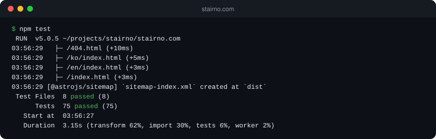
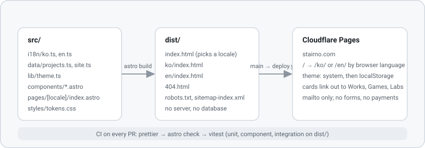

# stairno.com

[**Quickstart**](#quickstart) | [**How it works**](#how-it-works) | [**Configuration**](#configuration) | [**Examples**](#examples) | [**FAQ**](#faq)

**stairno.com** is the hub site for the **Stairno** brand: **what Stairno is, and links to its three projects** (Works, Games, Labs). It is a **static site with no backend**, built with Astro 7, served in **Korean and English** with **light and dark themes**, and deployed to Cloudflare Pages from the `main` branch. Node 22.22 or newer, npm, no other runtime.


[](https://github.com/seren-wib/stairno.com/actions/workflows/ci.yml)
[](https://github.com/seren-wib/stairno.com/actions/workflows/deploy.yml)
[](CHANGELOG.md)
[](https://nodejs.org/)
[](https://astro.build/)

[](#how-it-works)
[](#how-it-works)
[](CONTRIBUTING.md)

## Updates

- [2026/10/18] **Shared design package.** Tokens, base styles, header, footer, theme toggle, locale switch, theme script and fonts now come from [stairno-ui](https://github.com/seren-wib/stairno-ui) (`@stairno/ui` v0.1.0). Pixel-identical build; the hub keeps only its own sections.
- [2026/10/17] **v0.1.0, first build.** Brand intro, three project cards, news placeholder, contact link, two locales, two themes, 75 tests, CI and a Cloudflare Pages deploy workflow. [Changelog](CHANGELOG.md)

## Star History

<a href="https://star-history.com/#seren-wib/stairno.com&Date">
  <picture>
    <source media="(prefers-color-scheme: dark)" srcset="https://api.star-history.com/svg?repos=seren-wib/stairno.com&type=Date&theme=dark" />
    <source media="(prefers-color-scheme: light)" srcset="https://api.star-history.com/svg?repos=seren-wib/stairno.com&type=Date" />
    
  </picture>
</a>

## Table of Contents

- [Why](#why)
- [Quickstart](#quickstart)
- [How it works](#how-it-works)
- [What the build produces](#what-the-build-produces)
- [Configuration](#configuration)
- [Examples](#examples)
- [Commands](#commands)
- [FAQ](#faq)
- [Contribution](#contribution)

## Why

Stairno runs three projects on three domains. Without a hub:

- Someone who searches the name lands on one project and never learns there are others.
- Each project site has to explain the brand again, in two languages, and the copies drift.
- Selling, intake and payment pages pull the brand page into their own stack and release cycle.

stairno.com keeps the brand page small and separate:

- **One page per language.** Intro, three cards, a news placeholder and a mail link. Nothing else.
- **No backend.** `astro build` writes HTML, CSS and about 10 KB of JS. There is nothing to patch or scale.
- **Content lives in data files.** Copy in `src/i18n/`, projects in `src/data/`. Changing words never touches a component.
- **Tests gate every change.** Unit, component and built-output tests run on each pull request before merge.

## Quickstart

### Requirements

- **Node 22.22 or newer** and **npm** on your `PATH`
- git

### 1. Clone and install

```bash
git clone https://github.com/seren-wib/stairno.com.git
```

```bash
cd stairno.com && npm ci
```

> [!IMPORTANT]
> Use `npm ci`, not `npm install`. The lockfile pins Astro and Vitest to the versions the tests were written against.

### 2. Run the dev server

```bash
npm run dev
```

Open `http://localhost:4321/`. It sends you to `/ko/` or `/en/` based on your browser language.

### 3. Check it works

```bash
npm test
```

The last project builds the site into `dist/` and checks the output, so this takes a few seconds.

<p align="center">
  
</p>

## How it works

<p align="center">
  
</p>

Astro renders `src/pages/[locale]/index.astro` once per locale from the dictionaries in `src/i18n/`. The root `index.html` holds a small script that reads `navigator.languages` and redirects, with a `<noscript>` fallback to Korean. A theme script in `<head>` runs before paint: a stored choice in `localStorage` wins, otherwise `prefers-color-scheme` decides. Everything else is CSS variables. The tokens, the base stylesheet, the header, the footer, the two toggles, that theme script and the font links come from the shared package [`@stairno/ui`](https://github.com/seren-wib/stairno-ui), pinned to a git tag in `package.json`, so every Stairno site shares one look and this repository holds only the hub sections.

A few details:

- **Both dictionaries share one type.** A key missing from `ko` or `en` fails `astro check`; an empty string fails a unit test.
- **The inline theme script is tested against the TypeScript logic.** The integration suite runs the built `<script>` with fake storage and `matchMedia` and compares it with `resolveTheme`.
- **The hub never grows commerce.** A built-output test fails if a form, an input, or intake and payment wording appears.
- **One gesture, one screen.** The page scrolls like slides: a wheel notch, a swipe or an arrow key moves exactly one screen (hero, projects, news, contact, footer). On the projects screen the same gesture turns one card instead, and only past the last card does the page move on. Each project card fills the whole viewport. No timer. Section headings and the current header menu item are drawn as dots that assemble when they appear.
- **The hero is drawn, not loaded.** A canvas samples a pure dot field (`src/lib/dots.ts`) on a 14px grid: a halftone staircase and a star that hops to the top step. On the first paint the whole picture is wrapped around a dot globe that turns and unfolds flat. No image files ship with the site.
- **Black, white and greys, two themes.** The hero, contact band and footer are always black with white dots; body tokens are declared on `html[data-theme]`, so switching is one attribute.

The design documents (plan, requirements, design, test and deploy) live in Google Docs; [CLAUDE.md](CLAUDE.md) lists them and the rules that follow from them.

## What the build produces

<details>
<summary><b><code>npm run build</code> output tree</b></summary>

```
dist/
├─ index.html          picks /ko/ or /en/ from the browser language
├─ ko/index.html       Korean home
├─ en/index.html       English home
├─ 404.html            both locales' not-found copy
├─ robots.txt
├─ sitemap-index.xml
├─ sitemap-0.xml
├─ favicon.svg
├─ og.png            Open Graph image for link previews
└─ _astro/             one hashed stylesheet (package base + hub styles), slider, reveal and dot-canvas scripts
```

</details>

## Configuration

- **`src/data/site.ts`**: brand name, production origin, contact email, GitHub link. The email is the only place the `mailto:` target is set.
- **`src/data/projects.ts`**: the three cards, in order, with a URL and a name and description per locale.
- **`src/i18n/ko.ts`, `src/i18n/en.ts`**: every visible string. Both must satisfy `Dictionary` in `src/i18n/types.ts`.
- **`@stairno/ui` in `package.json`**: the shared design package, pinned to a tag (`github:seren-wib/stairno-ui#v0.1.0`). Colours, type scale, header, footer and toggles change there, then the tag is bumped here.
- **`src/styles/global.css`**: hub-only styles (hero, sections, slider, news, contact, 404) on top of the package tokens.
- **`public/`**: `favicon.svg`, the Open Graph image `og.png` and `robots.txt`, copied into `dist/` as they are.
- **`astro.config.mjs`**: `site`, trailing slashes, locales and the sitemap integration.
- **GitHub secrets `CLOUDFLARE_API_TOKEN` and `CLOUDFLARE_ACCOUNT_ID`**: when both exist, `deploy.yml` uploads `dist/` to the Pages project `stairno-com` on every push to `main`. Until then the workflow builds and skips the upload.

## Examples

<details>
<summary><b>Change the contact address</b></summary>

Edit `email` in `src/data/site.ts`. The Contact section, the component test and the built-output test all read it from there.

```bash
npm run test:unit
```

</details>

<details>
<summary><b>Add a fourth project card</b></summary>

Append an entry to `src/data/projects.ts` with `id`, `url`, `name` and `description` for both locales, then update the expected id list and count in `tests/unit/projects.test.ts` and `tests/component/sections.test.ts`.

```bash
npm test
```

</details>

<details>
<summary><b>Preview the production build</b></summary>

```bash
npm run build && npm run preview
```

</details>

## Commands

| Command                | What it does                                               |
| ---------------------- | ---------------------------------------------------------- |
| `npm run dev`          | Dev server with hot reload on `http://localhost:4321/`     |
| `npm run build`        | Static build into `dist/`                                  |
| `npm run preview`      | Serve `dist/` locally                                      |
| `npm test`             | Unit, component and integration tests (includes one build) |
| `npm run test:unit`    | Unit and component tests only                              |
| `npm run check`        | `astro check`: TypeScript across `.ts` and `.astro` files  |
| `npm run format`       | Prettier, write                                            |
| `npm run format:check` | Prettier, check only (what CI runs)                        |

## FAQ

### 1. The deploy workflow says `Build passed, deploy skipped.`

The two Cloudflare secrets are not set on the repository. Add `CLOUDFLARE_API_TOKEN` (Pages edit scope) and `CLOUDFLARE_ACCOUNT_ID` under Settings → Secrets and variables → Actions, then rerun the workflow or merge the next pull request.

### 2. `/` always opens the Korean page

Your browser's language list has no entry starting with `ko`, or scripts are disabled. With scripts off, the `<noscript>` meta refresh goes to `/ko/` by design. Use the language link in the header; the choice is a plain URL, so bookmark `/en/`.

### 3. Integration tests fail right after cloning

They read `dist/`, which the integration project builds in its global setup. If a previous build was interrupted, remove `dist/` and run the full suite again:

```bash
npm test
```

## Contribution

Bug reports about the two locales, the theme switch and the built output are welcome, as are fixes with a failing test first. Branch, commit and merge rules are in [CONTRIBUTING.md](CONTRIBUTING.md).

If this hub layout saves you from writing a brand page three times, a ⭐ helps other people find it.
